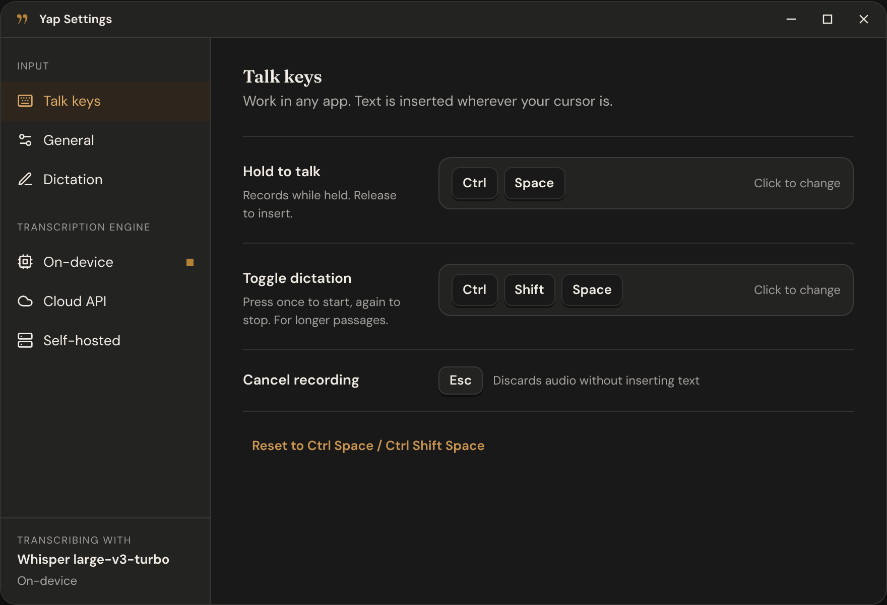

# Yap

Hold a key, talk, let go. Your words show up wherever your cursor is: an email, Slack, a doc, your code editor, a search box. That's Yap.

Out of the many tools that are made for productivity, voice typing has been one that has stuck with me in my workflow. However, most options want an account, a subscription and your audio on their servers.



## Your voice is yours

What you say can be private: messages, notes, work you can't share. So Yap leaves the choice of where your audio goes to you, and the default is that it goes nowhere.

- **On your computer.** Download a speech model once and everything happens on your PC. No account, no internet needed, nothing uploaded.
- **Your own server.** Running Whisper on a box at home? Your audio stays on your network.
- **A cloud provider, if you want one.** Use your own API key with a service you already trust. Yap only sends audio there when you've picked it.

Either way, Yap only listens while you're dictating, and it doesn't keep recordings. Your dictation history only covers today and stays on your computer, and API keys live in Windows Credential Manager or the macOS Keychain, not in a settings file.

And to be clear: I have no interest in tracking what you say. There's no analytics, no telemetry, no account. The only time Yap goes online is to download a model you asked for or to reach the cloud provider you picked. Your data is yours, and honestly, I don't want to hear about your bad ideas :)

## What's good about it

- **Works in any app.** If you can type there, you can talk there.
- **Lots of models to choose from.** Parakeet, Whisper, Moonshine and Nemotron, from tiny and fast to big and accurate.
- **Live text.** With a streaming model, your words show up while you're still talking.
- **Optional clean-up.** A small model on your computer can strip out the "um"s and false starts, fix punctuation and turn spoken lists into bullet points.

## How to use it

1. Hold **Ctrl + Space** and talk.
2. Let go. Yap types what you said where your cursor is.
3. Didn't mean it? Press **Esc** while you're recording to toss it, or hit **Undo** on the little overlay after it's inserted.

For longer stuff, tap **Ctrl + Shift + Space** to start and tap it again when you're done (up to 5 minutes). Don't like those keys? Change them in Settings.

While you're talking, a small bar at the bottom of the screen lets you know Yap is listening. The tray icon lets you switch engines or look back at what you dictated today.

## Pick where the speech-to-text happens

### On your computer

Grab a model in Settings and Yap runs it locally. No internet needed after the download, and every download is checked against a pinned checksum.

| Model | Download | Good for |
| --- | --- | --- |
| Parakeet TDT 0.6B v3 | 487 MB | The one to start with. Fast on most PCs, 25 European languages, figures out the language on its own. |
| Parakeet TDT 0.6B v2 | 482 MB | English only, really quick. |
| Whisper tiny / base / small | 78 MB to 488 MB | 99 languages. Smaller is faster, bigger is more accurate. |
| Whisper medium / large-v3 / large-v3-turbo | 1.5 GB to 3.1 GB | 99 languages, best accuracy. large-v3-turbo is nearly as good as large-v3 and a lot faster. |
| Moonshine tiny / base | 30 MB / 111 MB | English. Light enough for older or low-power laptops. |
| Nemotron Streaming (EN, or 3.5 multilingual) | about 470 MB | Shows your words in the overlay while you're still talking. |

### Cloud API

Already paying for a speech API? Add your key in Settings. Your audio goes to that provider for each dictation and it's billed to your account.

- Works now: OpenAI, Groq, Fireworks AI, and any OpenAI-compatible API (just give it a base URL).
- On the list: Deepgram, AssemblyAI, ElevenLabs, Google Cloud, Azure, AWS Transcribe and Speechmatics.

### Your own server

If you run Whisper or another speech model on a home server or GPU box, drop its URL into Settings. Anything that speaks the OpenAI transcription format (`/v1/audio/transcriptions`) works, with an optional auth token.

## Clean-up

Off by default. Download one of the clean-up models in Settings (Qwen3.5 2B at 1.3 GB, or Qwen3.5 4B at 2.7 GB) and flip it on. It runs entirely on your computer and only tidies up your words. It won't answer questions or add anything. If it ever fails or takes too long, Yap just inserts what you actually said.

## What you need

- Windows 10 or 11 (64-bit), or macOS 11.3 or later (Apple Silicon or Intel)
- A microphone
- For Whisper models, a processor with AVX2 (most Intel and AMD processors from 2013 on; some budget Pentium and Celeron chips don't have it).
- For on-device models, some disk space for the model you pick. Parakeet and the smaller Whisper models run fine on a normal laptop CPU.

Linux is on the way.

## Install

### Windows

Grab the latest `Yap_x.y.z_x64-setup.exe` from [Releases](https://github.com/codyrowland/yap/releases) and run it. It installs just for your user and adds Yap to the Start menu. If you're missing the Microsoft Visual C++ runtime, the installer adds it (Windows will ask for permission once).

The installer is signed, but Windows may still say "Windows protected your PC" while the certificate is new. Under **More info**, the publisher should read **Cody Rowland**; click **Run anyway**.

### macOS

Grab the latest `Yap_x.y.z_aarch64.dmg` (Apple Silicon) or `Yap_x.y.z_x64.dmg` (Intel) from [Releases](https://github.com/codyrowland/yap/releases), open it and drag Yap to **Applications**. Yap is signed and notarized by Apple.

Yap needs the Accessibility permission to hear your talk keys and type into other apps. Turn Yap on in **System Settings › Privacy & Security › Accessibility**.

### First run

The first time you open it, a quick setup checks your mic, has you pick an engine and talk keys, and lets you try it out.

## Build it yourself

You'll need Rust (1.88 or newer), the Visual Studio C++ build tools and CMake.

```
cd app/src-tauri
cargo run
```

To build the installer, install the Tauri CLI once and run the build script:

```
cargo install tauri-cli --version "^2" --locked
powershell -ExecutionPolicy Bypass -File app/src-tauri/windows/build-installer.ps1
```

The installer ends up in `app/src-tauri/target/release/bundle/nsis/`.

## Where it's at

Yap is in early testing, so expect some rough edges. If something breaks or you have an idea, open an issue.
